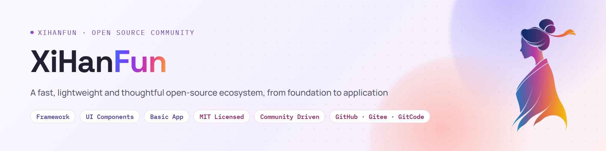

<h1>XiHanFun</h1>

<b>An enterprise-grade open-source ecosystem for .NET + TypeScript</b>

<b>English</b> | <a href="https://github.com/XiHanFun/.github/blob/main/profile/README_cn.md">简体中文</a>

  
  

  
  

The core products are the backend foundation XiHan.Framework, the frontend foundation XiHan.UI and the basic application XiHan.BasicApp. Each is released on its own, and together they make a ready-to-use admin system. The print, flow, form and report designers are ecosystem products that embed into any frontend project.

The [website](https://www.xihanfun.com) covers what each product is for, what it can do and which editions exist. The [ecosystem docs](https://docs.xihanfun.com) hold the ecosystem overview, cross-repository quick starts and selection guides. Every product also has its own documentation site. Both sites are in Chinese.

## Core Products

The backend foundation, the frontend foundation and the basic application each own one layer. Use any of them alone, or combine them into a complete admin system.

| Project | About |
| :-- | :-- |
| **[XiHan.Framework](https://github.com/XiHanFun/XiHan.Framework)** Backend foundation  | **A fast, lightweight, efficient and thoughtfully built modern modular framework for .NET** Modules are assembled by their dependency graph, and application services become endpoints through the dynamic API. Multi-tenancy, workflows, the event bus and AI integration work out of the box, with native .NET features preferred. [Docs site](https://framework.docs.xihanfun.com) |
| **[XiHan.UI](https://github.com/XiHanFun/XiHan.UI)** Frontend foundation  | **A fast, lightweight, efficient and thoughtfully built framework-agnostic headless UI component library** State machines and accessibility logic live in a headless core, and the Vue, React and Web Components adapters share the same behavior. Basic and AI components cover everything from admin screens to AI chat. [Docs site](https://ui.docs.xihanfun.com) |
| **[XiHan.BasicApp](https://github.com/XiHanFun/XiHan.BasicApp)** Basic application  | **A beautifully crafted general-purpose admin kernel built on XiHan.Framework and XiHan.UI** RBAC with data scopes and field masking, tenant isolation, code generation, realtime messaging and AI features come built in. With a database ready, one command each starts the backend and the frontend. [Docs site](https://basicapp.docs.xihanfun.com) · [Live demo](https://basicapp.xihanfun.com) |

## Ecosystem Products

The designers ship as native Web Components and are not tied to any frontend framework, so they work in Vue, React, Angular or framework-free pages alike. Their runtimes pull in no third-party packages; templates are plain JSON, and data, storage and permissions are handed to the host through callbacks.

| Project | About |
| :-- | :-- |
| **[XiHan.PrintDesigner](https://github.com/XiHanFun/XiHan.PrintDesigner)** Print designer `@xihan-print/*`  | **A fast, lightweight, efficient and thoughtfully built framework-agnostic print designer** Design print templates visually, then preview pages and print in the browser; with the local print client, print silently. [Docs site](https://print.docs.xihanfun.com) |
| **[XiHan.FlowDesigner](https://github.com/XiHanFun/XiHan.FlowDesigner)** Flow designer `@xihan-flow/*`  | **A fast, lightweight, efficient and thoughtfully built framework-agnostic flow designer** Compose flowcharts and approval flows visually and export engine-neutral flow definitions for your own engine. [Docs site](https://flow.docs.xihanfun.com) |
| **[XiHan.FormDesigner](https://github.com/XiHanFun/XiHan.FormDesigner)** Form designer `@xihan-form/*`  | **A fast, lightweight, efficient and thoughtfully built framework-agnostic form designer** Build forms visually, with one JSON definition driving both the designer and form rendering in business pages. [Docs site](https://form.docs.xihanfun.com) |
| **[XiHan.ReportDesigner](https://github.com/XiHanFun/XiHan.ReportDesigner)** Report designer `@xihan-report/*`  | **A fast, lightweight, efficient and thoughtfully built framework-agnostic report designer** Design data reports and dashboards visually, with data supplied by the host through callbacks; reports export to xlsx worksheets. [Docs site](https://report.docs.xihanfun.com) |

## Where to Start

The BasicApp backend builds on Framework and its frontend on UI; the designers build on UI. Take just one layer, or start from the complete admin system.

| If you want | Start here |
| :-- | :-- |
| Backend capabilities only, as NuGet packages in an existing ASP.NET Core project | [Framework quick start](https://framework.docs.xihanfun.com/quickstart) |
| Frontend components only, with Vue, React or native custom elements | [UI quick start](https://ui.docs.xihanfun.com/quickstart) |
| A working admin system to write your business on top of its permissions, tenants and auditing | [BasicApp getting started](https://basicapp.docs.xihanfun.com/getting-started) · [Live demo](https://basicapp.xihanfun.com) |
| A print, flow, form or report designer embedded in your own pages | [Print](https://print.docs.xihanfun.com/quickstart) · [Flow](https://flow.docs.xihanfun.com/quickstart) · [Form](https://form.docs.xihanfun.com/quickstart) · [Report](https://report.docs.xihanfun.com/quickstart) |
| A clear picture of how the projects fit together before choosing | [Ecosystem overview](https://docs.xihanfun.com/cosmos/ecosystem) |

## Get Involved

- Every project is open source under the MIT License; the open-source editions are complete and free for commercial use.
- The code is hosted on [GitHub](https://github.com/XiHanFun) (primary), [Gitee](https://gitee.com/XiHanFun) and [GitCode](https://gitcode.com/XiHanFun) (synced mirrors), and issues and pull requests are welcome on any of them.
- Before contributing code, please read the [contributing guide](https://github.com/XiHanFun/.github/blob/main/CONTRIBUTING.md) and the [Contributor Covenant](https://github.com/XiHanFun/.github/blob/main/CODE_OF_CONDUCT.md).
- QQ group: [462371834](https://qm.qq.com/q/qYp1Urv3z2) · Email: me@xihanfun.com
